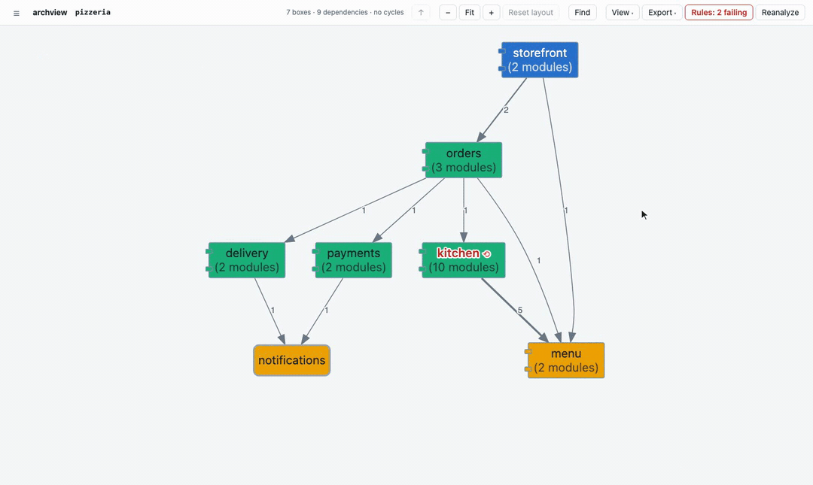

# archview

AI agents can't quietly break your architecture.

You write down which parts of your code may import which. `archview check` reads the
real imports and fails, with the file and the line, as soon as a change crosses that
line. It holds an agent on its fortieth edit to the same rules as you on your first.



## Why

Agents write most of the code now. They are fast, and they don't care which way a
dependency points. Ask one to fix a bug in checkout and it will import the payment
client from your domain model if that is the shortest path. Each change looks fine on
its own. A few weeks later nothing can be moved without moving everything.

Uncle Bob's answer, in
[LIVE: Uncle Bob on Software Fundamentals in the Age of AI](https://www.youtube.com/watch?v=zcLPGC-tvgk&t=1615s)
(26:55), is to split the work. The human looks at the structure and decides how the
code is partitioned and which way dependencies run. That decision goes in a file, and a
fast, deterministic checker keeps the agents inside it. He built
[arch-view](https://github.com/unclebob/arch-view) and
[dependency-checker](https://github.com/unclebob/dependency-checker) for Clojure.
archview is based on the same idea.

## Quick start

```bash
uv tool install git+https://github.com/LiorHalfon/arch-viewer@latest
cd your-repo && archview .
```

`archview .` opens the viewer in your browser. To run it once without installing:
`uvx --from git+https://github.com/LiorHalfon/arch-viewer@latest archview .`

Python needs nothing else. TypeScript needs Node and the repo's own `npm install`,
because archview resolves imports with the repo's `typescript`, exactly as `tsc` does.

The demo from the GIF is in this repo:

```bash
git clone https://github.com/LiorHalfon/arch-viewer && cd arch-viewer
archview examples/pizzeria
```

## Hold agents to it

1. `archview init` writes `archview.toml` from the imports as they are today, so the
   check passes straight away.
2. Delete the dependencies that should not exist. From then on `archview check` fails
   until the code matches.
3. Run the check where an agent can't skip it: CI, pre-commit, and Claude Code's Stop
   hook, which hands the failure back to the agent before it can finish.

In the demo, the rules for the kitchen's assembly line say `boxing` takes pizzas from
the `oven` only. The code disagrees, and `toppings` and `oven` import each other:

```
$ archview check examples/pizzeria
pizzeria.kitchen.stations (pizzeria/kitchen/stations/archview.toml)  2 problems
  VIOLATION boxing -> dough (1 import) not allowed by [archview.allowed.boxing]
    pizzeria/kitchen/stations/boxing.py:3  from pizzeria.kitchen.stations.dough import stretch
    hint: boxing may import only: oven. Move the code that needs dough, go through an allowed component, or ask a human to change the rule.
  CYCLE oven -> toppings -> oven (2 edges)
    pizzeria/kitchen/stations/oven.py:3      from pizzeria.kitchen.stations.toppings import top
    pizzeria/kitchen/stations/toppings.py:5  from pizzeria.kitchen.stations import oven  [pizzeria.kitchen.stations.oven]
    hint: break the cycle where it is thinnest: oven -> toppings (1 import) - invert that dependency or move the code.
2 problems in 7 components and 1 nested scope. exit 1
```

Each problem names the file, the line and a way out, and the hint is written for an
agent: fix the code, or ask a human to change the rule. A short paragraph in your
`CLAUDE.md` or `AGENTS.md` says the same, and points the agent at questions it can ask
instead of guessing: `archview why A B`, `archview deps X`, `archview rdeps X`,
`archview cycles`. The paragraph, the hook and the full rules reference are in
[docs/06-using-archview-in-a-repo.md](docs/06-using-archview-in-a-repo.md).

## What the viewer shows

- Packages and modules as boxes in layers, with arrows from importer to imported and
  the import count on each line.
- Click a package to go inside it, click a module to read its source, and use the
  breadcrumb to go back up.
- Cycles in red, with a panel that breaks each one into its loops. A package with a
  cycle somewhere inside it gets a red name, so you can follow it down.
- Broken rules as dashed lines. Click one to see the imports behind it.
- Boxes coloured by role, instability or zone ([what those mean](docs/metrics.md)).
  Drag boxes around, find any module with `/`, export SVG, PNG, Mermaid or DOT.
- `archview serve --watch` redraws as the code changes.

## Commands

| Command | What it does |
|---|---|
| `archview .` | Open the viewer (short for `archview serve .`) |
| `archview init` | Write `archview.toml` from today's imports |
| `archview check` | Exit 0 when the code follows the rules, 1 when it doesn't, 2 when it can't run. `--format json` for scripts |
| `archview graph` | The current level as text, `--json`, `--dot` or `--mermaid` |
| `archview metrics` | Ca, Ce, instability, abstractness, distance and zone per component |
| `archview why A B` | The imports behind A -> B, or the shortest chain |
| `archview deps X`, `archview rdeps X` | What X imports, what imports X |
| `archview cycles` | Every cycle at every level, with its imports |

## Python, TypeScript and monorepos

archview reads Python with [grimp](https://github.com/seddonym/grimp) and an `ast`
pass, and TypeScript with the repo's own compiler. Both land in the same model, so the
viewer and the rules work the same way for each. A monorepo can check several packages
as one architecture, each with its own rules file and a declared public surface
([workspace mode](docs/06-using-archview-in-a-repo.md#workspace-mode)).

archview never runs your code and never touches the network. The one exception is
TypeScript, where it runs the repo's installed `typescript` package to resolve imports.

## Docs

- [Using archview in a repo](docs/06-using-archview-in-a-repo.md): adoption, the rules reference, a baseline for legacy code, hooks
- [Metrics](docs/metrics.md): instability, abstractness, distance and the zones
- [Architecture](docs/05-architecture.md) and [decisions](docs/decisions/): how archview itself is built
- [Requirements](docs/02-requirements.md)

## Credits

The idea and the metrics come from Uncle Bob's
[arch-view](https://github.com/unclebob/arch-view) and
[dependency-checker](https://github.com/unclebob/dependency-checker). Imports come from
[grimp](https://github.com/seddonym/grimp), and Graphviz lays out every view through
[viz-js](https://github.com/mdaines/viz-js). archview checks its own architecture in
CI, with its own `archview.toml`.

MIT licence.
